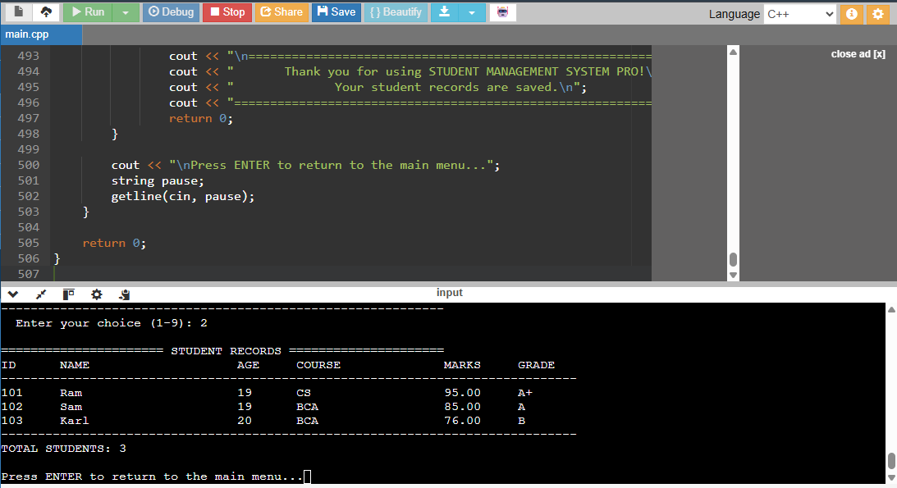

# Student Management System Pro

**A console-based application built with C++ to simplify student record management.**

Student Management System Pro is a menu-driven application that allows users to manage student information, maintain academic records, and view class performance statistics. It uses file handling to store records locally, so information remains available even after the program is closed.

## Overview

Managing student records manually can become time-consuming, especially when information needs to be updated or retrieved frequently. This project provides a simple and organised way to perform common student management operations through a command-line interface.

## Features

- **Add Student:** Register a new student with an ID, name, age, course, and marks.
- **View Records:** Display all registered students in a structured table.
- **Search Student:** Find a student using their unique ID.
- **Update Details:** Modify an existing student's information.
- **Delete Record:** Remove a student record with confirmation.
- **Input Validation:** Prevent invalid entries, duplicate IDs, and marks outside the 0–100 range.
- **Grade Calculation:** Automatically assign grades based on marks.
- **Result Status:** Determine whether a student has passed or failed.
- **Class Statistics:** Calculate class average, highest and lowest marks, pass count, and pass percentage.
- **Top Performer:** Identify the student with the highest marks.
- **Sort Records:** Arrange students according to marks in descending order.
- **File Storage:** Save and retrieve student records using a local text file.


## Application Preview

### Student Records

The application displays student information in an organised table, including student IDs, names, courses, marks, and grades.




## Technologies Used

| Technology | Purpose |
|---|---|
| C++ | Core programming language |
| Structures | Organising student information |
| Vectors | Managing student records |
| File Handling | Storing and retrieving records |
| Standard Template Library (STL) | Sorting and other utility operations |

## Grade System

| Marks | Grade |
|---|---|
| 90–100 | A+ |
| 80–89 | A |
| 70–79 | B |
| 60–69 | C |
| 50–59 | D |
| Below 50 | F |

A student is considered to have passed with a score of **40 or above**.

## Getting Started

### Requirements

- A C++ compiler supporting C++11 or later.
- A terminal or command-line environment.

### Compilation

Clone the repository:

```bash
git clone https://github.com/preetha-codes/student-management-system.git
```

Navigate to the project folder:

```bash
cd student-management-system
```

Compile the program:

```bash
g++ -std=c++11 main.cpp -o student_management
```

Run the application:

**Linux / macOS**
```bash
./student_management
```

**Windows**
```bash
student_management.exe
```

## Data Storage

Student records are stored in a local file named `students.txt`.

The application automatically creates or updates this file when records are saved. Existing records are loaded when the program starts again, allowing data to persist between sessions.

## Project Structure

```text
student-management-system/
│
├── main.cpp       # Main application source code
├── README.md      # Project documentation
└── students.txt   # Generated automatically during use
```

*Note: `students.txt` is created when the application saves student records. It may not be present in the repository initially.*

## Testing

The application was tested for its main operations, including:

- Adding and displaying student records.
- Searching, updating, and deleting records.
- Handling duplicate student IDs.
- Validating user input.
- Calculating grades and class statistics.
- Identifying the top performer.
- Sorting student records.
- Saving records and retrieving them after restarting the program.

The file persistence and final execution checks were successful.

## Learning Outcomes

This project provided practical experience with:

- C++ fundamentals and control structures.
- Functions and modular programming.
- Structures and dynamic data management.
- Input validation and error handling.
- File input/output operations.
- Applying STL algorithms to real-world problems.

## Author

**Preetha Maria Rosalind Subramani**

GitHub: [@preetha-codes](https://github.com/preetha-codes)

---

*This project was developed for educational purposes as a practical application of C++ programming concepts.*
